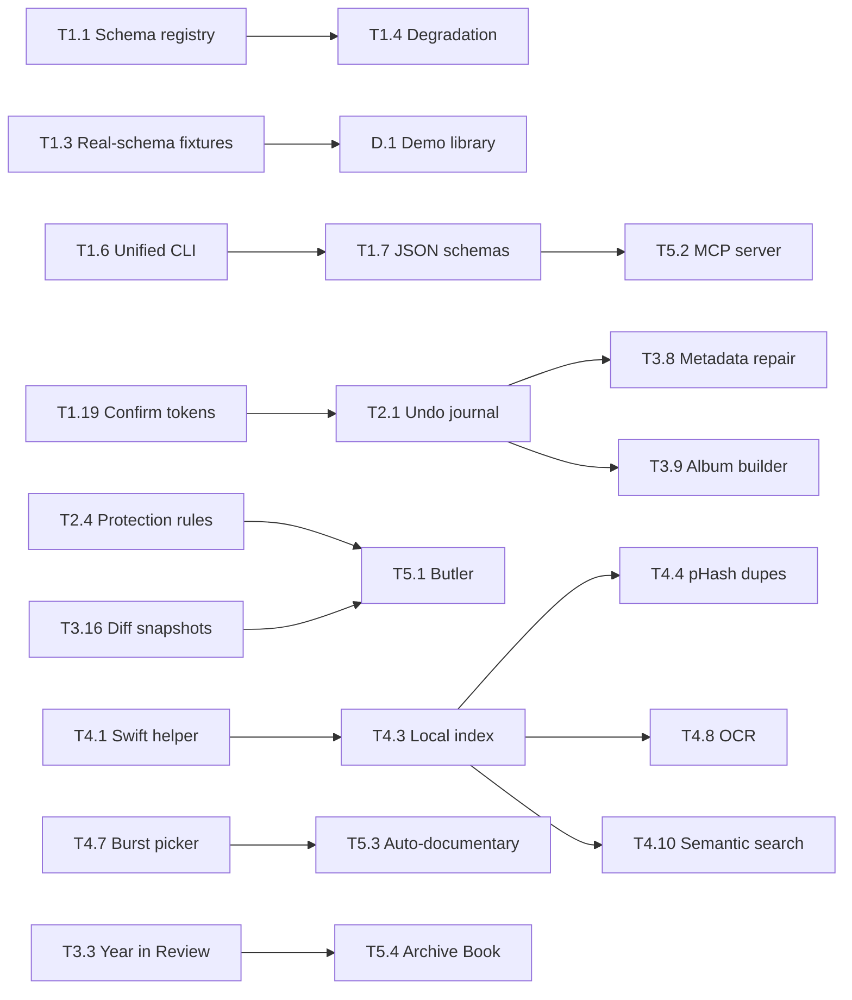

# Roadmap

Where `apple-photos-cleaner` goes after 1.0. It starts with maintenance and builds up to the
moonshots. Each tier assumes the tiers below it are mostly done. Pick work from the lowest tier
that still has open items unless something higher is blocking a release.

> Status as of 2026-10-15: **v1.3.0** (scene search on macOS 26) ready to ship; v1.2.0 on ClawHub. 21
> commands (incl. `doctor`), stdlib-only, read-only analysis + two token-confirmed mutating commands.
> ~95% coverage, CI on macOS × Python 3.10 / 3.14 / 3.15. Verified against a real macOS 26 library.
> ✅ marks shipped items.

---

## At a glance

| Now (next ~6 weeks) | Next (this half) | Later (this year and beyond) |
| --- | --- | --- |
| ~~Fix local-time date math~~ ✅ | Unified `photos-cleaner` CLI | Native Swift helper (PhotoKit + Vision) |
| ~~Mutation confirmation tokens~~ ✅ | Versioned JSON schemas | Perceptual duplicates, OCR, semantic search |
| ~~Schema registry + `doctor`~~ ✅ | Undo journal + protection rules | HTML dashboard, Year in Review |
| ~~SKILL.md diet (≤ 250 lines)~~ ✅ | Demo library + Homebrew/pipx install | MCP server, Library Butler, auto-documentary |

---

## Guiding principles

These are the constraints every feature has to respect. If a feature can't meet one of them,
it ships as an opt-in extra or it doesn't ship.

1. **Read-only by default.** Nothing writes to `Photos.sqlite`, ever. Mutations go through
   Photos.app (AppleScript / PhotoKit), preview first, and need explicit confirmation.
2. **Local-first, zero network.** No telemetry, no uploads. Any feature that needs the network
   is opt-in, off by default, and documented in the Privacy section.
3. **Stdlib core.** The core install stays dependency-free. Heavier features (pixel analysis,
   embeddings) live behind optional extras or a separately shipped native helper.
4. **Agent-native.** JSON output is the API. Every command has a stable schema an LLM can rely on,
   and `SKILL.md` stays cheap to load.
5. **Reversible.** Every mutating operation records what it did and can be undone.
6. **Explainable.** Every recommendation says *why* ("lower sharpness than its burst sibling,
   not favorited, not in any album"). No unexplained scores.
7. **Privacy-proportional.** The more sensitive a result (faces, places, documents), the more it
   is aggregated or redacted by default.

## How to read this

| Field | Meaning |
| --- | --- |
| **ID** | `T<tier>.<n>`. Use it in issues, branches, and commit scopes |
| **Size** | **S** ≤ 1 day · **M** ≤ 1 week · **L** ≤ 1 month · **XL** multi-month |
| **Done when** | The acceptance bar. A feature isn't shipped until this is true |

Items marked ⭐ are high-impact relative to their size. Start there when choosing within a tier.

---

## Tier 0: Keep the lights on

Ongoing hygiene. Not glamorous; skipping it is how a skill ends up quietly broken after the next
macOS release.

### Correctness & cleanup

| ID | Item | Size | Done when |
| --- | --- | --- | --- |
| T0.1 ⭐ ✅ | **Fix UTC-only date math.** `coredata_to_datetime` ([_common.py:107](scripts/_common.py#L107)) returns naive UTC, and every `strftime(... 'unixepoch')` query skips `'localtime'`. As a result, peak hour, On This Day, streaks, seasonal buckets and year boundaries are all shifted for anyone not on UTC. Use the per-asset time zone offset where the schema has one and fall back to the system zone | M | A photo taken at 23:30 local on Dec 31 lands in the right year/day/hour; regression tests cover +/- offset fixtures |
| T0.2 ✅ | **Remove personal references from public docs.** [SKILL.md:1249](SKILL.md#L1249) mentions a specific person's machine; example output uses real family names | S | No personal names or machines in shipped files; a test greps for a denylist |
| T0.3 ✅ | **Drop the irrelevant Lighthouse workflow.** This is a Python CLI, not a site | S | Workflow removed or excluded by the consistency guard |
| T0.4 ✅ | **Replace the stale "Future Enhancements" section** in SKILL.md with a link to this file | S | SKILL.md points here; no duplicated wish list |
| T0.5 ✅ | **Audit SKILL.md claims against code.** Every flag, default and output field documented in SKILL.md/README actually exists | S | A test parses each script's `argparse` and diffs against the documented flags |

### Supply chain & security

| ID | Item | Size | Done when |
| --- | --- | --- | --- |
| T0.6 ✅ | **Pin GitHub Actions by SHA.** Renovate keeps the pins fresh | S | No `@v4`-style refs in workflows |
| T0.7 | **Release provenance.** Build release archives in CI with artifact attestations + an SBOM; checksums in release notes | S | Every GitHub release has attestation and `SHA256SUMS` |
| T0.8 ✅ | **Security regression tests.** AppleScript injection (filenames with quotes, backslashes, newlines, Unicode), path traversal in `--output-dir`, SQL built from user input | S | A dedicated `tests/test_security.py`; CodeQL stays clean |
| T0.9 ✅ | **Threat model doc.** What the skill trusts (DB contents, filenames, album titles, agent input) and why | S | `docs/threat-model.md` linked from SECURITY.md |

### Cadence

| ID | Item | Size | Done when |
| --- | --- | --- | --- |
| T0.10 | **Dependency triage.** Keep the Renovate Dependency Dashboard (#3) at zero stale PRs | S, recurring | Monthly sweep; no dependency PR older than 30 days |
| T0.11 | **Annual macOS beta smoke test.** Every June, run the suite plus a manual pass against a beta library | M, recurring | A `docs/compat.md` row per macOS version with pass/fail per script |
| T0.12 ✅ | **Python version policy.** 3.9 is EOL. Decide the floor (3.10 recommended), update `requires-python`, ruff `target-version`, and CI matrix | S | Floor documented; CI matrix = floor + latest two |
| T0.13 ✅ | **Release checklist + CHANGELOG.** Keep-a-Changelog, backfilled to 1.0.0; version bump, tag, ClawHub publish verification, release-drafter notes | S | `RELEASING.md` and `CHANGELOG.md` exist; every release follows them |
| T0.14 | **Coverage ratchet.** Raise `fail_under` from 80 as coverage climbs | S, recurring | Ratchet bumped whenever actual coverage is ≥ 3 points above it |
| T0.15 | **Issue triage SLA.** Label and respond to new issues within a week | S, recurring | No unlabeled issue older than 7 days |
| T0.16 ✅ | **Deprecation policy.** Flags and JSON fields get one minor release of warnings before removal | S | Policy in CONTRIBUTING.md; deprecations emit to `warnings` in JSON |

---

## Tier 1: Foundations

Platform work that makes everything above it cheaper and safer. Nothing here is a headline
feature, but most later tiers depend on it.

### 1A. Schema resilience

The biggest existential risk is Apple changing `Photos.sqlite` underneath us. Today, schema
detection is ad-hoc (`detect_face_schema`, per-script `PRAGMA table_info` checks).

| ID | Item | Size | Done when |
| --- | --- | --- | --- |
| T1.1 ⭐ ✅ | **Central schema registry.** One module that introspects the DB once, records which tables/columns exist, and maps logical names (`face.person_fk`, `asset.trashed`) to physical columns. All scripts use it | L | No script calls `PRAGMA table_info` directly; adding a renamed column is a one-line change |
| T1.2 ✅ | **Schema fingerprinting.** Hash table and column sets → known macOS version. Unknown fingerprint = warning, not crash | M | `doctor` reports "macOS 26 schema (known)" or "unknown schema: features X, Y degraded" |
| T1.3 | **Real-schema fixtures.** Schema-only `CREATE TABLE` dumps (no real rows) from each supported macOS version, plus a synthetic data generator that fills them | L | The suite runs every script against every fixture schema; hand-written in-memory tables reduced to unit tests |
| T1.4 ✅ | **Graceful degradation contract.** Every script declares required vs optional columns; missing optional → that section returns `null` with a `degraded` reason | M | Removing any single optional column from a fixture never crashes a script |
| T1.5 | **Schema drift bot.** A scheduled workflow diffs a contributor-submitted schema dump (via `doctor --schema-dump`) against known fingerprints and opens an issue | M | New macOS schemas surface as issues within days of release |

### 1B. One CLI, one contract

| ID | Item | Size | Done when |
| --- | --- | --- | --- |
| T1.6 ⭐ | **Unified entry point.** `photos-cleaner <command>` (and `python3 -m photos_cleaner`) dispatching to the existing scripts. Scripts keep working standalone | M | `photos-cleaner --help` lists all commands; SKILL.md examples use it |
| T1.7 | **Versioned JSON output schema.** Every result gets `{"schema_version", "command", "generated_at", "library", "data", "warnings", "degraded"}`. Publish JSON Schema files in `schemas/` | L | Schemas validated in tests; changing a field shape fails CI |
| T1.8 | **Consistent flags.** `--db-path`, `--library`, `--output`, `--format`, `--year`, `--start-date/--end-date`, `--limit`, `--quiet`, `--verbose` everywhere they make sense | M | A test walks every parser and asserts the shared flag set |
| T1.9 ✅ | **Exit codes.** 0 ok, 2 usage, 3 DB not found, 4 permission denied, 5 schema unsupported, 10 user aborted, 11 confirmation required | S | Documented and tested; agents can branch on them |
| T1.10 ⭐ ✅ | **`doctor` command.** Checks Python, DB location, Full Disk Access, Automation permission, schema fingerprint, library size, iCloud "Optimize Storage" state, optional helper presence. Prints concrete fixes | M | First thing SKILL.md tells an agent to run when anything fails |
| T1.11 | **Config file.** `~/.config/photos-cleaner/config.toml` for defaults (thresholds, hemisphere, protected albums, redaction level). CLI flags override | S | `tomllib` on 3.11+, minimal fallback parser for older Pythons |
| T1.12 | **Importable Python API.** A real package (`photos_cleaner`) so other tools can `from photos_cleaner import junk` instead of shelling out | M | Scripts become thin wrappers; API documented and typed |
| T1.13 | **Accessible terminal output.** Respect `NO_COLOR`, `--no-emoji`, screen-reader-friendly `--human` mode (no box art, no bar charts) | S | Every `--human` formatter has a plain variant |

### 1C. Performance at scale

Libraries of 100k–500k assets are common. Several scripts load everything into Python.

| ID | Item | Size | Done when |
| --- | --- | --- | --- |
| T1.14 | **Benchmark harness.** Synthetic 10k / 100k / 500k libraries; `make bench` reports wall time + peak RSS per command | M | Numbers in `docs/perf.md`; CI flags >25% regressions on the 10k set |
| T1.15 | **Push aggregation into SQL.** `GROUP BY` instead of Python loops; stream rows instead of `fetchall()` | M | Every command finishes on 100k in < 10 s on an M1 |
| T1.16 ⭐ ⏸ | **Snapshot + cache layer.** *Deferred (2026-10): measured on a real 15.7k-photo macOS 26 library, every command finished in ≤ 1.5 s once timeline_recap's per-event index lookups were fixed, and no "database is locked" occurred. A snapshot would copy the whole library database (names, faces, places) to a cache, so it waits until a measurement shows a need, and would then be opt-in, owner-only and expiring.* Copy `Photos.sqlite` (+ WAL) to a temp snapshot once per session for a consistent view with no lock contention; cache derived results keyed by DB mtime | M | Repeated runs in one agent session are near-instant; no "database is locked" errors |
| T1.17 | **Similarity beyond O(n²).** Bucket by time window + dimensions, or LSH over the feature vector, so `--limit 500` stops being necessary | M | Full-library similarity on 100k in < 60 s |
| T1.18 | **Progress reporting.** Long runs emit progress on stderr (human bar, or JSON lines with `--progress json` for agents) | S | Any command > 2 s shows progress; stdout JSON stays clean |

### 1D. Safety engineering

Belt-and-braces around the two things that must never go wrong: writing to the database and
deleting the wrong photo.

| ID | Item | Size | Done when |
| --- | --- | --- | --- |
| T1.19 ⭐ ✅ | **Confirmation tokens for mutations.** Today `cleanup_executor` confirms with `input()` ([cleanup_executor.py:506](scripts/cleanup_executor.py#L506)), which an agent can satisfy by piping `yes`. `smart_export` skips confirmation entirely off-TTY ([smart_export.py:383](scripts/smart_export.py#L383)). Instead: preview emits a plan hash; execute requires `--confirm <hash>` and refuses if the candidate set changed | M | Nothing executes without a matching token from a preview; documented as the agent flow in SKILL.md |
| T1.20 ✅ | **SQLite authorizer guard.** On top of `mode=ro`, install `set_authorizer` that denies every write opcode, so a future bug can't write even against a misopened connection | S | Test proves an `INSERT` through `connect_db` raises |
| T1.21 | **Mutation rate limits.** Hard cap per run (default 500, ceiling configurable), and a cool-down warning when > N items were deleted in the last 24 h | S | Exceeding the cap requires an explicit flag *and* a new token |
| T1.22 | **Fuzz + property tests.** Hypothesis-style tests (dev-only dependency) over timestamp conversion, AppleScript escaping, folder sanitizing, and query builders | M | Runs in CI with a bounded example count |

### 1E. Agent experience

| ID | Item | Size | Done when |
| --- | --- | --- | --- |
| T1.23 ⭐ ✅ | **SKILL.md diet / progressive disclosure.** The manifest is ~1,300 lines that agents pay for on every load. Slim it to a router (≤ 250 lines); move per-command detail into `references/commands/<name>.md` | M | SKILL.md ≤ 250 lines; manifest test enforces the cap |
| T1.24 | **Token-budget-aware output.** `--summary` (a few hundred tokens) vs `--full`; list results paginate with a cursor instead of dumping 10k rows | M | Default output of every command fits under a documented token budget |
| T1.25 | **`next_actions` in every result.** Structured suggestions such as `{"command": "cleanup_executor", "args": [...], "why": "287 old screenshots, 2.1 GB"}` | S | Agents chain commands without re-reading docs |
| T1.26 | **Trigger + task evals.** Eval set of user prompts → expected command and key facts in the answer; run against SKILL.md changes | M | `make eval` passes; runs in CI on SKILL.md changes |
| T1.27 | **Prompt cookbook.** 50 realistic user requests with the ideal command sequence and response style | S | `references/cookbook.md`, linked from SKILL.md |

---

## Tier 2: Make the existing features great

Deepen what's already there before going wide.

### Cleanup & safety

| ID | Item | Size | Done when |
| --- | --- | --- | --- |
| T2.1 ⭐ | **Undo journal.** Every mutating run writes a journal (UUIDs, filenames, timestamp, category, token). `photos-cleaner undo <run-id>` restores from Recently Deleted | M | Round-trip test: delete → undo → asset back in library |
| T2.2 | **Cleanup plans as files.** `junk_finder --plan plan.json` emits a reviewable plan; `cleanup_executor --plan plan.json` executes exactly that list | M | What the user reviewed is byte-for-byte what gets executed |
| T2.3 ⭐ | **Review album instead of delete.** `--to-album "Cleanup Review"` puts candidates into an album to eyeball in Photos.app first | S | Works for every cleanup category |
| T2.4 | **Protection rules.** Never touch favorites, items in named albums, photos of named people or pets, or anything matching `protect` rules in the config | M | Rules applied on every mutating path, covered by tests |
| T2.5 | **More junk categories.** Screen recordings, pocket shots (very dark/tiny/blurred, burst-adjacent), near-black/near-white frames, accidental 1-second videos, images saved from messaging apps | L | Each category has a fixture and a documented precision note |
| T2.6 | **Edited-pair awareness.** Detect original + edited duplicates; never recommend deleting the only edited copy | M | Duplicate finder respects adjustments |
| T2.7 | **Recently Deleted analysis.** What's in the trash now, how much space emptying it reclaims, what expires this week | S | New section in `storage_analyzer`; read-only |
| T2.8 | **Duplicate confidence tiers.** `certain` (same hash/size/time), `likely`, `possible`, each with its own default action | S | Cleanup defaults to `certain` only |

### Insight quality

| ID | Item | Size | Done when |
| --- | --- | --- | --- |
| T2.9 ⭐ | **Better offline geocoding.** Ship a compressed GeoNames cities15000 extract (~25k places, ~1 MB) instead of ~100 cities; country/admin-region rollups | M | Most clusters resolve to a named town; no network |
| T2.10 | **Home/work inference + redaction.** Detect home/work clusters and redact them by default (`--reveal-home` to show) | M | Home coordinates never appear in output unless asked for |
| T2.11 | **Trip detection v2.** Distance-from-home + duration + day boundaries; named trips ("Chicago, Jul 3–7 2025"); countries visited "passport" | M | Matches a hand-labeled fixture with ≥ 90% agreement |
| T2.12 | **Use Apple's curation signals.** Overall aesthetic score, curation/promotion scores, Memories, Moments, Featured Photos where the schema has them | M | Best-photos ranking blends them when available |
| T2.13 | **Keywords, captions, titles.** Read user-entered metadata; search by it; report untitled favorites | S | `scene_search --text "graduation"` hits captions and keywords |
| T2.14 | **Camera & lens analytics.** Device/lens, focal-length distribution, ProRAW/ProRes usage, "you never use the telephoto" | M | New `gear_report` command |
| T2.15 | **Video deep-dive.** Duration, resolution, codec, frame rate, slo-mo/time-lapse/cinematic; savings from re-encode estimates | M | New `video_analyzer` command |
| T2.16 | **Golden hour & sky context, offline.** Compute sun elevation from GPS + local time with pure-math solar position; tag golden hour, blue hour, night shots; moon phase | S | `photo_habits` reports "18% of your best shots are golden hour" |
| T2.17 | **Pets as first-class.** Recent macOS names pets alongside people; split them out, and give per-pet reports | S | `people_analyzer --pets` works where the schema supports it |

### Media types & sources

| ID | Item | Size | Done when |
| --- | --- | --- | --- |
| T2.18 | **Import source analysis.** Camera vs AirDrop vs messaging apps vs imports vs shared, using the import-source columns where present | M | "31% of your library arrived via messaging apps; 4 GB of it is memes" |
| T2.19 | **RAW + JPEG pairs.** Detect pairs, report the storage cost, and suggest keeping one side per policy | S | Pair report with savings estimate |
| T2.20 | **Format optimization estimates.** Savings from HEIC/HEVC vs JPEG/H.264 originals; Live Photo → still savings (existing) unified into one optimizer view | S | One `optimize` view summarizing every format lever |
| T2.21 | **Panoramas, portraits, selfies, spatial.** Per-type stats and best-of lists, including spatial photos/videos where present | S | New sections in `library_analysis` |
| T2.22 | **Shared Albums (not Shared Library).** Analyze iCloud Shared Albums separately: subscribed, contributed, storage implications | M | New `shared_albums` command |

### Output

| ID | Item | Size | Done when |
| --- | --- | --- | --- |
| T2.23 | **Markdown + CSV output.** `--format md\|csv\|json\|human` | S | Every command supports it |
| T2.24 | **Thumbnails in reports.** Resolve derivative paths inside the library bundle (read-only) so reports show the real photo | M | `best_photos --format html` shows real images |
| T2.25 | **GPX / GeoJSON export.** Location clusters and trips as GPX/GeoJSON for any map app | S | Opens in Apple Maps / Google Earth; home redacted by default |
| T2.26 | **Localization.** Human output and narratives translatable; date/number formats follow locale | M | gettext-style catalogs; one non-English locale shipped as proof |

---

## Tier 3: New capabilities

New commands that open up use cases the skill doesn't cover yet.

### Reports & storytelling

| ID | Item | Size | Done when |
| --- | --- | --- | --- |
| T3.1 ⭐ | **Library Health Score.** One 0–100 score with sub-scores (junk, duplicates, organization, sync coverage, metadata completeness) and the three highest-impact fixes | M | `photos-cleaner health` gives one paragraph an agent can quote |
| T3.2 | **HTML dashboard report.** Single self-contained `report.html`: storage treemap, timeline heatmap, people graph, map, junk breakdown | L | Opens offline; under 5 MB for a 100k library |
| T3.3 ⭐ | **Year in Review.** Wrapped-style recap: top people, places, best shot per month, streaks, firsts, stats; HTML + narrative JSON with per-section privacy toggles | L | Shareable recap generated in one command |
| T3.4 | **Growing-up timeline.** For a chosen person or pet: best photo per month across years, as a contact sheet or slideshow export | M | `people_analyzer --timeline "<name>"` |
| T3.5 | **"Who's missing."** People you used to photograph often who've disappeared from the library in the past N months | S | Gentle phrasing guidance in SKILL.md; opt-in |
| T3.6 | **Trip journal.** Per trip: day-by-day narrative, map (GPX), best shots, people; Markdown + HTML | M | One command per trip, or every trip in a year |
| T3.7 | **Photo stats for nerds.** Shutter/ISO/aperture distributions where EXIF is cached, sharpest lens, best hour, most-photographed weekday per person | S | `gear_report --deep` |

### Library management

| ID | Item | Size | Done when |
| --- | --- | --- | --- |
| T3.8 | **Metadata repair suggestions.** Missing/wrong dates (1970, scanner dates), missing GPS inferable from time-neighbors, wrong time zone after travel | M | Suggestions with confidence; optional apply with undo journal |
| T3.9 | **Album builder from natural language.** "All photos of Alex at the beach in summer 2024" → compiled query → preview → regular album (Photos can't script *smart* albums; documented) | L | Previewed album, journaled, undoable |
| T3.10 | **Auto-albums.** Suggested albums for detected trips, events, and recurring occasions (birthdays, holidays) | M | Suggestions only; creating them goes through T3.9's path |
| T3.11 | **Shared Library planner.** Suggest what to move into the Shared Library (photos with family members, family events) and what to keep personal | M | Plan file + preview; apply via helper once T4.2 exists |
| T3.12 | **Multi-library support.** Analyze several `.photoslibrary` bundles; cross-library duplicates; merge planning | L | `--library A --library B` works for analysis commands |
| T3.13 | **Archive mode.** Export everything older than N years to external storage (originals + JSON sidecars + XMP), verify checksums, *then* offer cleanup | XL | Verified export before any deletion is proposed |
| T3.14 | **Sensitive content audit.** Find photos of documents likely to hold IDs, passports, card numbers or medical info (scene labels first, OCR once T4.8 lands) and suggest moving them to Hidden | M | Counts only by default; never echoes the contents |

### Planning & personalization

| ID | Item | Size | Done when |
| --- | --- | --- | --- |
| T3.15 ⭐ | **Personal taste model.** Learn *your* weighting of Apple's quality sub-scores from your favorites with a small stdlib logistic regression; rank hidden gems by it | M | Hidden-gem precision beats the global score on held-out favorites |
| T3.16 | **Diff / change tracking.** Snapshot stats over time; "since last month: +1,200 photos, +3.1 GB, 40% screenshots" | M | `photos-cleaner diff` against the last snapshot |
| T3.17 | **Storage forecast & plan optimizer.** Project when disk or iCloud fills up; what each cleanup buys in months; whether a plan tier change is avoidable | S | "You hit 200 GB in March 2027; clearing bursts buys 5 months" |
| T3.18 | **Unnamed-face triage.** Rank the largest unnamed face clusters so the user knows who to name next in Photos.app | M | Top-N clusters with sample asset and count |
| T3.19 | **Goals & streaks.** Opt-in photo habits goals ("one photo a day", "fewer screenshots"), tracked via T3.16 snapshots | S | Weekly digest mentions progress |

### Integrations (all local, all opt-in)

| ID | Item | Size | Done when |
| --- | --- | --- | --- |
| T3.20 | **Scheduled digests.** `launchd` plist generator for a weekly report into a folder of the user's choosing | S | Opt-in, documented, one-command uninstall |
| T3.21 | **Calendar correlation.** Match photo events to a user-provided `.ics` export to name events ("Soccer tournament") | M | No calendar access by default; file input only |
| T3.22 | **Contacts birthdays.** Opt-in read of Contacts birthdays to build "birthday through the years" collections | M | Separate permission, clearly documented |
| T3.23 | **Shortcuts integration.** Shipped Shortcuts that call the CLI (health check, On This Day, weekly review) | S | `.shortcut` files in `integrations/` |
| T3.24 | **Digital frame feed.** Keep a folder synced with a rotating curated set (best of this week in past years, per-person, seasonal) for any digital frame or kiosk | M | Export is idempotent, bounded in size, privacy-filtered |

---

## Tier 4: Intelligence

Getting past the metadata Apple already computed and looking at pixels, still entirely on
device. This is where the stdlib-only rule bends, so all of it ships as an **optional native
helper** and the core keeps working without it.

### The enabler

| ID | Item | Size | Done when |
| --- | --- | --- | --- |
| T4.1 | **`photos-helper` Swift binary.** Small signed, notarized CLI using PhotoKit + Vision + Core Image; Python calls it over stdin/stdout JSON | XL | Installed via Homebrew tap or release asset; core skill unaffected if absent |
| T4.2 | **PhotoKit-based mutations.** Move delete/favorite/album/metadata operations from AppleScript to PhotoKit: faster, batchable, better errors | L | AppleScript remains a fallback; 10× faster on 1k items |
| T4.3 | **Local index.** A sidecar SQLite index (outside the library bundle) for hashes, embeddings, OCR text; incremental updates keyed by asset UUID + modification date | L | Re-indexing a 100k library after a week of new photos takes minutes, not hours |

### What it unlocks

| ID | Item | Size | Done when |
| --- | --- | --- | --- |
| T4.4 ⭐ | **Perceptual-hash duplicates.** pHash/dHash over thumbnails catches resized, re-encoded, cropped, and screenshot-of-a-photo duplicates | L | Precision/recall reported against a labeled fixture set |
| T4.5 | **Vision feature-print similarity.** Replace quality-vector cosine with `VNGenerateImageFeaturePrintRequest` embeddings | L | Similar-photo groups match human judgment on a test set |
| T4.6 | **Blur, exposure, eyes-closed detection.** Pixel-level checks with explanations ("motion blur", "eyes closed: 2 of 3 faces") | M | Junk finder gains a `technical_flaws` category |
| T4.7 ⭐ | **Burst & series picker.** Best frame by sharpness + eyes open + smile + composition, with the reason | M | Agrees with a human on ≥ 80% of a labeled set |
| T4.8 | **OCR everything.** Vision text recognition over screenshots and documents; search inside them; classify receipts, tickets, boarding passes, whiteboards | L | `scene_search --ocr "confirmation number"` returns hits |
| T4.9 | **Utility vs memory classifier.** Separate "photos of life" from "photos of information" (receipts, parking spots, serial numbers) with an expiry policy for the latter | M | Utility photos older than 90 days surfaced as a cleanup category |
| T4.10 | **On-device semantic search.** Local image–text embeddings (Apple on-device models or a bundled CoreML CLIP-class model): "kids laughing in the snow at dusk" | XL | Index stored locally, never uploaded |
| T4.11 | **Screenshot intelligence.** Group screenshots by source app and content (OCR), dedupe repeated screenshots of the same screen, flag ones whose info is now stale | M | Screenshot cleanup ranked by "still useful?" |
| T4.12 | **Landmark & animal recognition.** Vision animal/landmark classifiers to enrich trips and pet reports | M | Trips mention recognized landmarks |
| T4.13 | **Video highlight detection.** Find the interesting seconds in long videos and suggest trims | XL | Trim suggestions with estimated storage saved |

---

## Tier 5: Moonshots 🚀

Ambitious and partly speculative. Each one needs a design doc before any code, and the
principles above still apply, especially local-first.

| ID | Moonshot | What it would feel like |
| --- | --- | --- |
| T5.1 | **Autonomous Library Butler** | A standing agent that runs the analysis weekly, drafts a cleanup plan inside the user's protection rules, puts it in a "Butler Review" album, and asks for one tap of approval. Learns from what the user rejects. Everything journaled and undoable |
| T5.2 | **"Talk to your library" (MCP server)** | The toolkit as a local MCP server so any MCP client can query it conversationally: "How many photos of grandma do we have from before 2015, and which are the best five?" Typed tools, streaming results, the same confirmation tokens |
| T5.3 | **Auto-documentary** | Pick a trip, person, or year and get a narrated film: clips and stills chosen by T4.7/T4.13, Ken Burns motion, music bed, LLM-written voice-over from timeline JSON, rendered locally with AVFoundation |
| T5.4 | **Family Archive Book** | Print-ready photo book PDF per year or per child: layout engine, captions from timeline + places + people, chapter per season, export to common print-service specs |
| T5.5 | **Life Graph** | A private, local knowledge graph of people, places, events, and relationships. Answers "When did we last see the Hendersons?" or "Who was at Sam's 5th birthday?" Interactive offline viewer |
| T5.6 | **Memory Resurfacing Engine** | A ranking model tuned to your favoriting history (building on T3.15), surfacing forgotten gems on meaningful anniversaries via notification or widget |
| T5.7 | **Cross-platform liberation** | Ingest Google Photos Takeout, Lightroom catalogs, and plain folders alongside Apple Photos; dedupe across them; plan one consolidated library |
| T5.8 | **Heirloom Mode** | Durable open formats, sidecar metadata, a printed index, and a "digital legacy" export a family member could open in 30 years without Apple software |
| T5.9 | **Restoration Studio** | On-device restoration for scanned and old photos: upscale, de-noise, colorize, fix fading. Results go to new assets beside the originals |
| T5.10 | **Oral History Mode** | The agent picks old photos and interviews a family member about them ("Who's this at the lake in 1994?"), then writes the answers back as captions with consent |
| T5.11 | **Family Curation Circle** | Several family members vote on best-of picks from a shared review set (local network or exported ballot file); results feed albums, books, and the frame feed |
| T5.12 | **Spatial memories** | Turn the best photos into spatial scenes and build immersive trip collections for headsets, chosen by depth-friendly composition |
| T5.13 | **Native Mac app + widget** | A menu-bar app over the same engine: health score at a glance, one-click weekly review, Year in Review on Dec 31. The CLI stays the source of truth |

---

## Cross-cutting track: Distribution, docs & community

Runs alongside the tiers; pick items up whenever a release needs them.

| ID | Item | Size | Done when |
| --- | --- | --- | --- |
| D.1 ⭐ | **Demo library.** A synthetic `demo.sqlite` (generated by T1.3's generator) shipped with the skill so anyone, including ClawHub reviewers and CI, can try every command with `--demo` without giving up Full Disk Access | M | Every SKILL.md example runs against `--demo` |
| D.2 | **Install paths.** `pipx install` / `uvx`, Homebrew formula, and the existing ClawHub listing, all from one release pipeline | M | One tag publishes everywhere |
| D.3 | **Claude plugin / skills marketplace packaging.** Package as a Claude Code plugin and list it wherever skills are discoverable | S | Installable in one command from at least two registries |
| D.4 | **README refresh.** Terminal GIF/asciinema per headline command, a 60-second quick start, a feature matrix | S | First screen shows what it does and how to run it |
| D.5 | **Docs site.** Generated from `references/` and JSON Schemas (GitHub Pages) | M | Per-command pages with flags, example output, and schema |
| D.6 | **Contributor onboarding.** `good first issue` labels, architecture overview, "add a new command" guide, schema-dump contribution guide (feeds T1.5) | S | A new contributor can add a command from the guide alone |
| D.7 | **Public roadmap board.** Mirror this file into a GitHub Project with one issue per ID | S | Board columns match the Now / Next / Later table |
| D.8 | **Showcase.** Example reports (from the demo library) in the README and docs site | S | HTML dashboard and Year in Review previews linked |

---

## Dependencies

The chains that decide ordering. Anything not shown can start independently.

---

## Release plan

Semver: a new JSON field is a minor; a removed or renamed one is a major.

| Release | Theme | Scope |
| --- | --- | --- |
| **1.0.3** ✅ | Hygiene patch | T0.1–T0.6, T0.8, T0.12, T0.13 |
| **1.1** ✅ | Solid ground | T1.1, T1.2, T1.4, T1.9, T1.10, T1.19, T1.20, T1.23, plus T0.9, T0.16 |
| **1.2** ✅ | Real-library fixes | Screen recordings split from screenshots (#37, part of T2.5), original filenames (#38) |
| **1.3** ✅ | Scene search on macOS 26 | Labels from Photos' search index (#35) |
| **1.4** | One CLI | T1.6–T1.8, T1.14–T1.16, T1.18, T1.25, T2.23, D.1 |
| **1.5** | Safe cleanup | T2.1–T2.4, T2.6–T2.8, T1.21, T3.1 |
| **1.6** | Richer insight | T2.9–T2.17, T3.15, T3.17, T3.18 |
| **1.7** | Media & sources | T2.18–T2.22, T2.25, D.2, D.3 |
| **2.0** | Reports & recaps | T1.7 schema v1 frozen, T1.12, T3.2–T3.7, T3.16, T2.24 |
| **2.x** | Library tooling | T3.8–T3.14, T3.19–T3.24, T1.17 |
| **3.0** | Native intelligence | T4.1–T4.4, T4.6, T4.7, T4.8 |
| **3.x** | Semantic | T4.5, T4.9–T4.13 |
| **Moonshots** | One at a time | T5.2 (MCP) first because it's mostly packaging T1.6/T1.7, then T5.1 and T5.3 |

---

## Non-goals

- **Writing to `Photos.sqlite`.** Not now, not behind a flag, not ever. It corrupts libraries.
- **Cloud processing of photos.** No feature uploads pixels or metadata anywhere.
- **Replacing Photos.app.** The skill augments Photos; it doesn't become a photo manager.
- **Non-macOS support for the live library.** Analyzing exported copies elsewhere is fine
  (T5.7 / T5.8); driving Photos.app outside macOS isn't possible.
- **Our own face recognition.** We read Apple's face data; we don't build a competing recognizer.
- **Social features.** No posting, sharing to networks, or public galleries.

## Risks & open questions

| Risk | Mitigation |
| --- | --- |
| Apple changes the schema in a way that breaks everything | T1.1–T1.5 plus the annual beta pass (T0.11) |
| AppleScript support for Photos is deprecated or further restricted | T4.2 moves mutations to PhotoKit; AppleScript kept as fallback |
| An agent deletes something the user didn't intend | T1.19 tokens, T1.21 caps, T2.1 undo, T2.3 review album, T2.4 protection rules |
| Signing and notarizing the Swift helper adds cost and process | Decide before 3.0: Apple Developer account, Homebrew tap, release automation |
| Optional extras fragment the user experience | `doctor` reports exactly which features are enabled and why |
| Privacy expectations rise as features get smarter | Every new data surface gets a row in the Privacy sensitivity table before it ships |
| Scope creep dilutes the core | Each tier gate: no Tier N+1 work in a release that leaves Tier N regressions open |

### Open questions

1. ~~Python floor: keep 3.9 for older macOS, or move to 3.10+?~~ Decided: 3.10 (1.0.3, T0.12).
2. HTML report (T3.2): static file or local web server?
3. MCP server (T5.2): bundled here or in a sibling repo?
4. Which on-device embedding model for T4.10, and what size can we bundle?
5. Does the Swift helper (T4.1) live in this repo or its own, with its own release cadence?
6. Demo library (D.1): generated at install time or committed as a binary fixture?

## Measuring success

- **Reliability:** zero crash reports per macOS release after the beta pass
- **Speed:** every command < 10 s on a 100k library (T1.15)
- **Safety:** zero unrecoverable deletions, with every mutation journaled (T2.1)
- **Agent fit:** trigger/task eval pass rate (T1.26), SKILL.md token size, median output tokens per command
- **Adoption:** ClawHub installs, GitHub stars, external contributors per release
